<picture>
  <source media="(max-width: 600px)" srcset="assets/manual-mode/hero-mobile.svg" />
  
</picture>

I build <strong>web apps, APIs and tools</strong> — from club software to experiments. Beyond code: design, photography, video and a lowered S5.

<a href="https://manuelheller.dev">Portfolio</a> · <a href="https://manuelheller.myportfolio.com">Photography</a> · <a href="https://joggediballa.ch">Jogge di Balla</a>

<a href="#skills">Skills &amp; experience</a> · <a href="#projects">All projects</a> · <a href="#activity">GitHub activity</a>

<picture>
  <source media="(max-width: 600px)" srcset="assets/manual-mode/stack-mobile.svg" />
  
</picture>

<picture>
  <source media="(max-width: 600px)" srcset="assets/manual-mode/projects-mobile.svg" />
  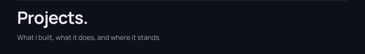
</picture>

<a href="https://github.com/manu-brighter/joggediballa-mainpage">
<picture>
  <source media="(max-width: 600px)" srcset="assets/manual-mode/project-club-mobile.svg" />
  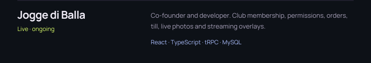
</picture>
</a>
<a href="https://github.com/manu-brighter/fly-connectome-sim">
<picture>
  <source media="(max-width: 600px)" srcset="assets/manual-mode/project-fly-mobile.svg" />
  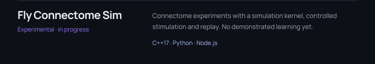
</picture>
</a>
<a href="https://github.com/manu-brighter/claude-code-kit">
<picture>
  <source media="(max-width: 600px)" srcset="assets/manual-mode/project-toolkit-mobile.svg" />
  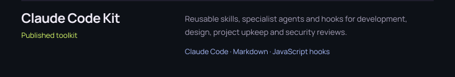
</picture>
</a>
<a href="https://github.com/manu-brighter/manus-portfolio">
<picture>
  <source media="(max-width: 600px)" srcset="assets/manual-mode/project-portfolio-mobile.svg" />
  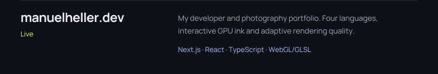
</picture>
</a>
<a href="https://github.com/manu-brighter/shot-counter">
<picture>
  <source media="(max-width: 600px)" srcset="assets/manual-mode/project-shot-counter-mobile.svg" />
  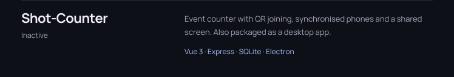
</picture>
</a>
<a href="https://github.com/manu-brighter/mercurius-quant-bot">
<picture>
  <source media="(max-width: 600px)" srcset="assets/manual-mode/project-mercurius-mobile.svg" />
  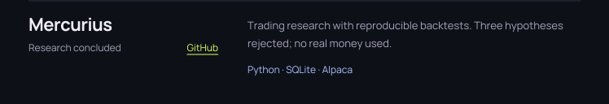
</picture>
</a>

Inside Jogge di Balla: from service to kitchen and bar

<a href="https://github.com/manu-brighter/joggediballa-mainpage">
<picture>
  <source media="(max-width: 600px)" srcset="assets/manual-mode/club-mobile.svg" />
  
</picture>
</a>

<a href="https://github.com/manu-brighter/manu-brighter/tree/chore/profile-data">
<picture>
  <source media="(max-width: 600px)" srcset="https://raw.githubusercontent.com/manu-brighter/manu-brighter/refs/heads/chore/profile-data/activity-mobile.svg" />
  
</picture>
</a>

<picture>
  <source media="(max-width: 600px)" srcset="assets/manual-mode/garage-mobile.svg" />
  
</picture>

<a href="https://manuelheller.myportfolio.com">View my photography</a>

<picture>
  <source media="(max-width: 600px)" srcset="assets/manual-mode/history-mobile.svg" />
  
</picture>

A few personal defaults

<pre><code>[defaults]
trailing_commas = always,
curiosity = enabled
outside_the_editor = camera_or_s5

[handle_with_care]
legacy_encoding = ISO-8859-1</code></pre>

<picture>
  <source media="(max-width: 600px)" srcset="assets/manual-mode/footer-mobile.svg" />
  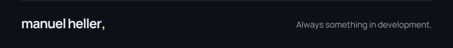
</picture>
